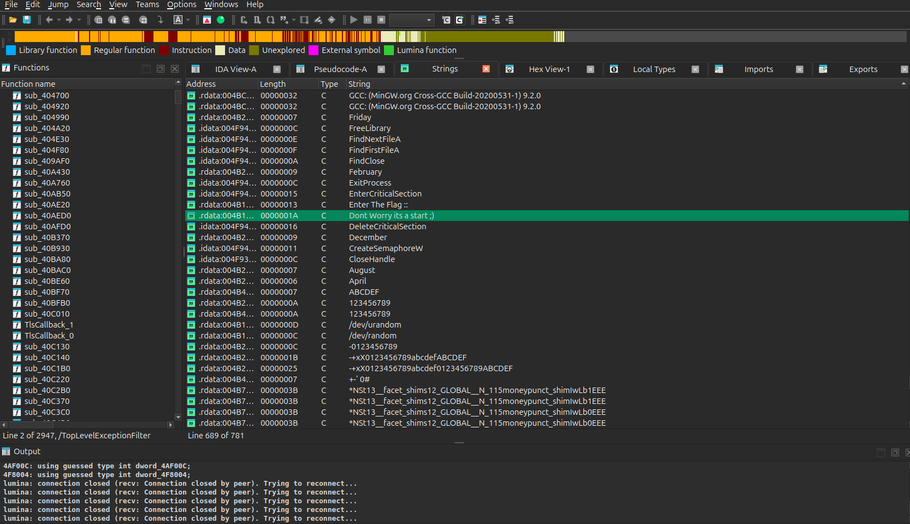
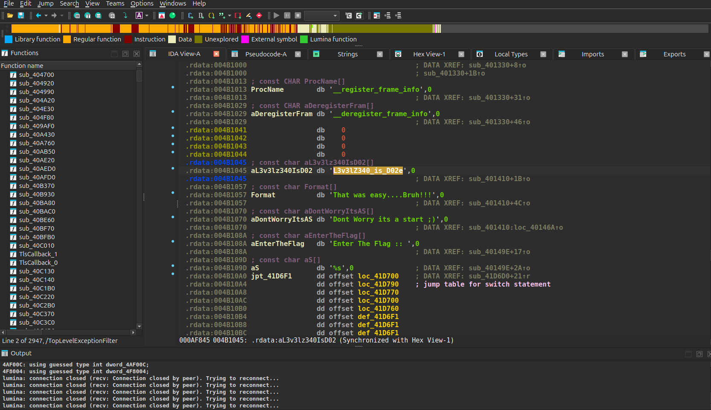
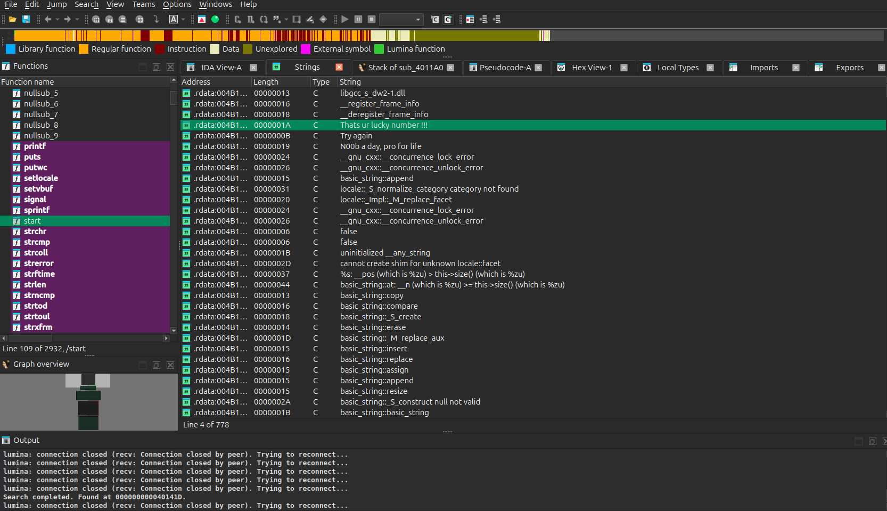
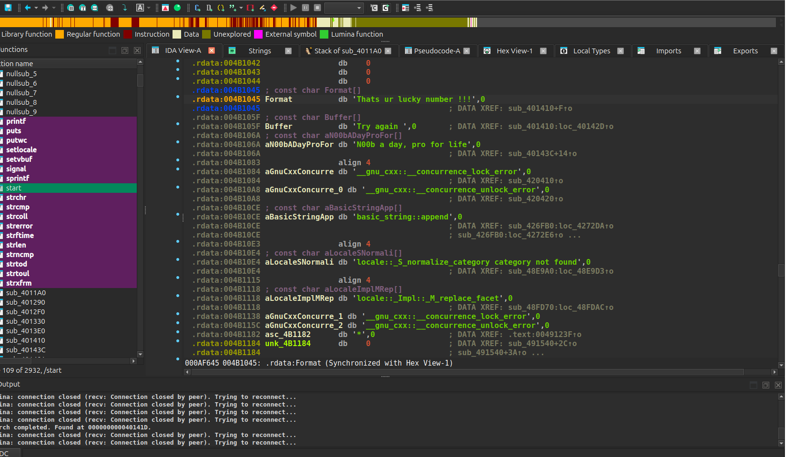
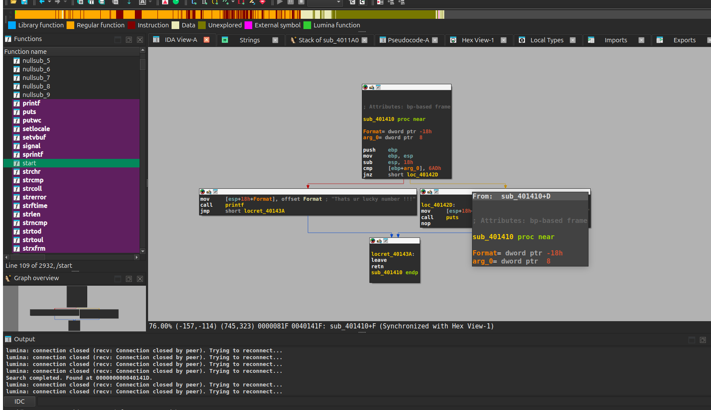
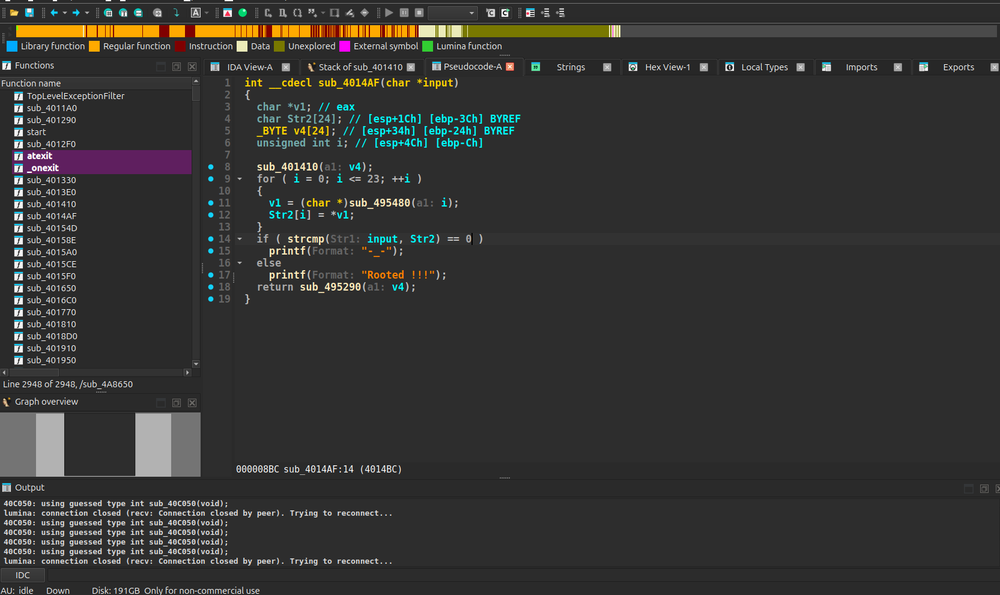
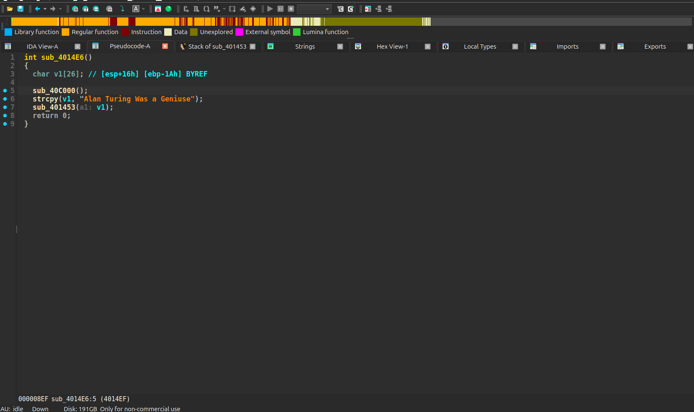

# TryHackMe: REloaded (Reverse Engineering, Hard)

My write-up for the **REloaded** room on TryHackMe. It's rated hard and it's a reversing room with a few small Windows `.exe` crackmes.

Quick honest note before I start: I haven't reversed many `.exe` files, so I froze a bit at the beginning. I also needed hints for the last two levels. I use Linux, so I opened everything in IDA and used `wine` to run the patched file.

---

## Level 0

This one was really easy, honestly. But since I'm not used to `.exe` files, I wasn't sure what to do first. The room's own hint said `strings`.

I thought the answer should be in the `strings` output. I had already tried it myself before, but I figured maybe I missed something. Nope, it really wasn't there.

So I opened the file in IDA. I knew right away that it has no `main`. My brain started going through 3-4 ideas. At first I thought it might be packed, but I don't think so: the program opened normally and it isn't squashed into one small section.

So I went to the C code (pseudocode) view. Before that I read a few lines of assembly in the same place to get a feel for it. There was nothing special in the C code.

Then I went to the Strings window. While scrolling around I saw a string that talks about the flag:



I jumped to that place, and yes, the answer was right there:



---

## Level 1

For the next one I looked for the `start` function right away, since I know that's the entry point. Now I had to analyze that function.

I had already tried these without any result:

- `strings`
- `ltrace`
- `strace`

One thing that helped: the answer I'm looking for is only 4 characters long.

I got a bit confused here too, so I took the hint from TryHackMe and gave it to an AI to explain what it actually says. The hint says to follow the path where the input gets compared, and to watch for `cmp` and `test`.

So I did that. I went to the Strings window (`Shift + F12`) and looked for something that talks about the flag or the input. One string caught my eye:



I clicked on it to see where it lives. I first wanted to press `X` to see where it's used, but it didn't work for me (I probably messed something up, or whatever the reason was), so I used the XREF comment instead:

```
DATA XREF: sub_401410+F↑o
```



That took me to `sub_401410`, where the input is compared with `6ADh`:



So we got the value. But note: this is **not** the answer yet. `6ADh` is hex, so you have to convert it to decimal (`0x6AD` = `1709`) and then submit that.

---

## Level 2

The task description:

> As a security analyst, you found some suspicious app in your organization which enables employees secretly share their file to the rival organization. Your task is to find who is involved in this treachery, but the app needs some key to log in. Can you patch this app to bypass Authentication?

Right from the start I guessed that a simple patch would solve it. The problem: I'm on Linux, and normally you'd need Windows to open and run this.

Then I became sure it has to be patched, because the room has two answers: one is the flag, and the other asks which instruction was changed.

I tried a little trick here: I entered the second question's answer first, just to see what happens. I typed:

```
jnz
```

and it was correct. So I had to find that instruction and change it to `jz`.

After some searching I found out I can run the file with `wine`. So I changed `jnz` to `jz`, saved the patch, and ran it:

```
wine Level-2_1610288072323.exe
```

and it gives the flag.

---

## Level 3

The task description:

> Bob was fired due to his inappropriate behavior with colleagues. While leaving he deleted the code which decrypts the password stored in the code. As a reverse engineer it's your task to recover that master password since the code is in prod now and cant is modified but you have a copy of the app. everything depends on you now !!!

So here we have to find a password.

I thought I could patch it, but I wanted to see if there's another way, because the room's hint said to look for something that gets XORed. So I kept looking around.

Here's the problem: if I patch it, I don't get the flag. It only says `Rotted`. What I actually need to find is the thing that gets XORed. The flag and the answer are the same thing.

I honestly had to take a hint on this one to understand what's what. After reading it I was like "ohhh". I had gone up to the comparison part, but I never went into the function where the key is. I got to this part (`sub_4014AF`) but I didn't open `sub_401410`, and the key was right there:



Let me tell you my path:

1. Went to the Strings window and searched for the word `flag`, then opened it.
2. Went to the Hex view.
3. Like before, went to the assembly code, then pressed `Tab` to get to the C code.
4. Went to a function called `sub_4014AF`.
5. Finally opened `sub_401410`, and the flag was there.

Next time I definitely have to pay more attention to which functions are used inside the code.

---

## Level 4

I downloaded the fourth one and opened it to see what it is. I thought it already gives the flag and I have to figure out how it's encrypted.

Honestly this one was a real problem for me and I had to go forward with a hint here too. And it was kind of ridiculous, because **the answer was in front of my eyes the whole time**.

I went into the assembly, read it, and followed the functions it calls. In the end I got the hex values and reversed them, because the processor is **little-endian**:



And that gave me the answer.

I think this one should at least have a prefix so I can recognize it as the flag. I wasted a lot of time on it, to be honest.

---

## Takeaways

- Follow **every** function the code calls, not just the one with the comparison (that's exactly what cost me Level 3).
- `strings` alone isn't always enough. Use the Strings window plus XREFs to see where the interesting string is actually used.
- Hex values coming out of assembly may need to be swapped around because of little-endian.

## Final thoughts

Even though it's rated hard, if you know what the answer looks like it's not that hard, and I think it could have been harder. I couldn't solve the last 2 on my own, but I think I could have, because the exact answer was right in front of me.

I'm going to solve other rooms to get better and better, but I enjoyed this one.
